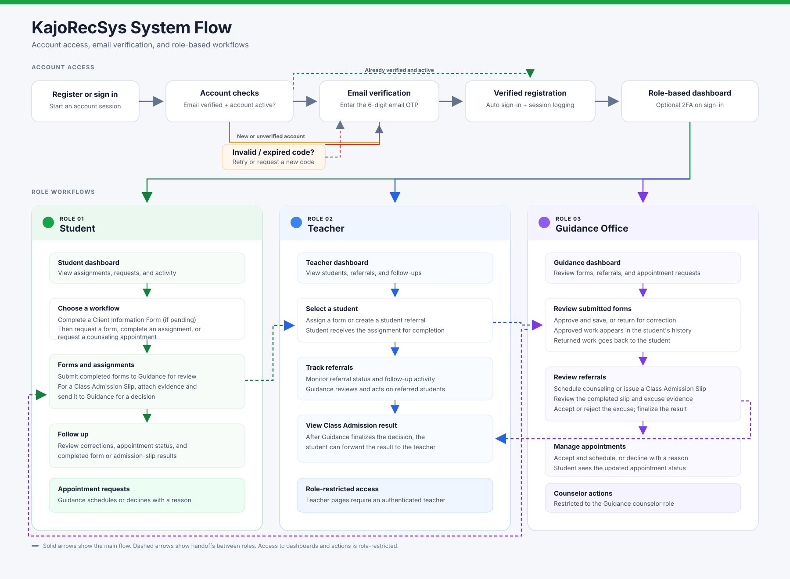
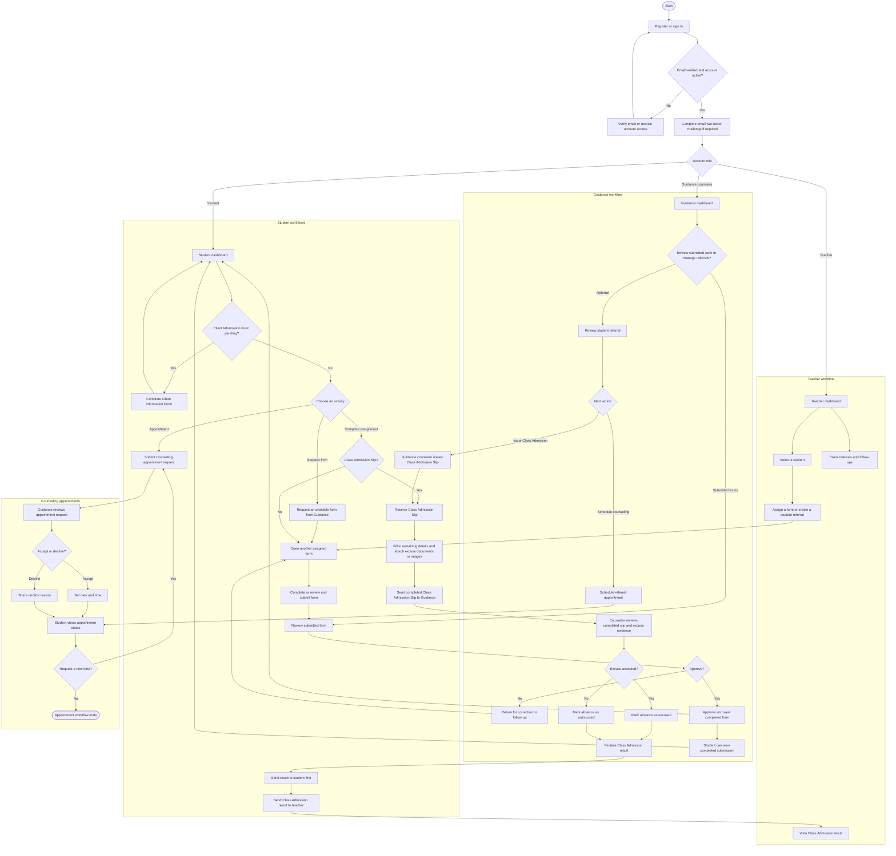

# KajoRecSys System Flowchart

The SVG version above is suitable for viewing or presentation. The Mermaid source follows.

The flowchart focuses on the primary student, teacher, and Guidance Office workflows. Access to dashboards and actions is restricted by account role.
